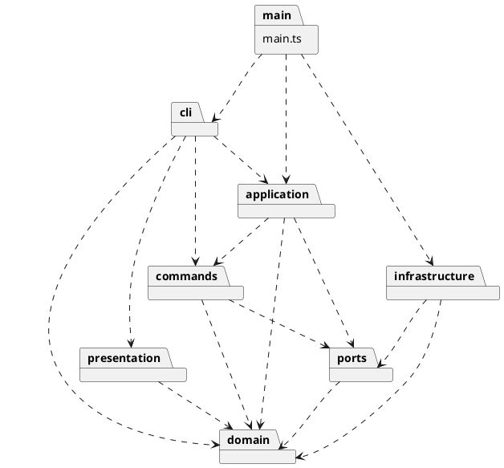

# Lab1 架构与开发记录

## 文档状态

第 5 阶段修订。CLI 的 init/create/move/undo/redo/tree/show/help、六种图形工厂与查询格式化已接入；其余编辑命令和 SVG 文件读写仍是后续计划。各阶段记录保留当时状态，以本节和最新阶段记录为当前实现范围。
需求依据：`../phase_cli_1.md`。当前范围为 CLI、六种内置图形和任务书列出的全部命令；不开发 Web 界面、box 或动态插件加载。

## 架构方案

### 模块划分

| 目录 | 职责 | 计划中的主要类 / 接口 |
|---|---|---|
| src/cli | REPL、分词、语法解析、命令分发、统一终端错误输出 | CliApplication、Tokenizer、Token、TokenCursor、CommandRouter、各命令 Parser |
| src/domain | 几何行为、图形树、全局 ID 唯一性、父子约束 | Shape、Rect、Circle、Ellipse、Line、TextShape、Group、SvgDocument、ShapeFactory |
| src/commands | 命令协议、操作及其恢复信息 | Command、UndoableCommand、MoveCommand、DeleteCommand 等 |
| src/application | 当前文档、执行协调、历史规则 | EditorSession、CommandExecutor、CommandHistory |
| src/ports | 文档读写接口、执行上下文所需的抽象接口 | DocumentRepository、CommandContext |
| src/infrastructure | XML 解析与输出、文件系统访问 | SvgFileRepository、SvgReader、SvgWriter |
| src/presentation | tree/show 的文本排版 | TreeFormatter、ShapeFormatter |
| src/main.ts | 组合入口，创建并连接具体实现 | 无领域逻辑 |
| tests | 领域约束、命令历史、CLI 与读写验证 | 按功能分组的测试 |

组件/包图源文件：[architecture.puml](architecture.puml)。以下为相同依赖规则的 PlantUML 包图，可用支持 PlantUML 的工具预览；本阶段未生成渲染图片。



### 设计模式的选择

- **Command（必需）**：编辑操作封装为命令对象，执行成功后才记入历史。历史管理器只调用接口，不识别具体命令名。查询命令不入栈；成功的文档操作触发历史屏障。undo/redo 不记录为新的编辑。第 4 阶段已落地 CreateCommand、MoveCommand 和统一历史管理，具体协议见最新阶段记录。
- **Composite**：Shape 为统一抽象，Group 保存有序子节点。叶子处理自身几何，容器通过多态递归操作；移动和缩放不得让同一个叶子重复变化。第 2 阶段已落地，详见下方实现记录与类图。
- **Factory / 类型注册**：六种类型通过 ShapeFactory 集中构造，CLI 创建与 SVG 导入复用同一类型注册入口。具体类型定义处理自身参数，避免输出和读取模块各写一套 switch(tag)。未来插件加载不在本阶段实现。
- **Memento 与局部恢复**：第 4 阶段采用 GeometrySnapshot 精确恢复移动前后的几何值；CreateCommand 保存创建对象及插入位置，撤销/重做通过文档维护索引。保留对象身份，不替换整份文档。未来 set/delete/group 需分别保存属性是否存在、父级和顺序，不能直接套用几何快照。

按名字分发仅保留两处：CommandRouter（命令名）和 ShapeFactory（图形类型名）。依任务书标为**待重构点**：后续改为可注入注册、减少修改中央清单的需求；注册表仍是名字分发，不能以此规避约束。
属性白名单由各图形封装，不在命令中根据图形类型分支。第 5 阶段 tree/show 使用 ShapeVisitor 与 Shape.accept() 双分派；SVG 输出尚未实现。访问者通过具体方法处理类型，不再新增类型名字分派。

### 依赖方向规则

1. domain 不依赖其他业务模块，不读取 stdin、不 console.log、不访问文件系统；负责保护状态约束。
2. ports 可以引用 domain 类型，不引用具体实现。CommandContext 抽象声明在 ports；命令不能反向依赖 application 的具体会话类，避免循环依赖。
3. commands 只依赖 domain、ports 及本模块协议；application 依赖 commands、domain、ports。
4. cli 可依赖 application、commands、presentation、domain 的参数/构造契约，不直接访问文件实现。语法校验属于 CLI，ID 存在性、环和归属校验属于领域执行过程。
5. infrastructure 实现 ports，依赖 domain；内层不依赖 infrastructure。presentation 只读取 domain 的公开查询能力，不修改模型。
6. main.ts 是组合根，可组装所有模块；测试可导入被测模块。禁止通过组合根中转业务逻辑。
7. 一类一文件，文件名与类名一致。属性和子节点不作为可任意修改的公共数据袋暴露。统一从文档入口维护树与 ID 索引。

### 变化点假设

| 变化点 | 当前预留 | 暂不实现及理由 |
|---|---|---|
| 增加图形类型 | Shape 多态和集中工厂 | 不实现动态插件系统，box 明确为后续阶段 |
| 增加命令 | Command 协议与命令解析器注册 | 不构建通用脚本语言 |
| CLI 改为 GUI/其他输入 | 输入输出与领域分离 | 不开发 Web 或鼠标交互 |
| 文件来源或格式变化 | DocumentRepository 接口 | 不支持网络存储或任意格式 |
| 撤销规模增加 | 独立历史管理器 | 本阶段不做持久化历史、压缩或无限历史优化 |
| 展示格式变化 | 独立 Formatter | 不自建 SVG 渲染器，浏览器预览即可 |

### 语义与边界决策

**任务书明确要求，后续必须遵守：**

- ID 全文档唯一且大小写敏感；create/group 必须显式命名，导入缺 ID 时补齐并警告。
- scale 因子为正，位置和尺寸一起缩放；容器递归处理子孙。
- 根级 g 不允许 ungroup。分组不能同时选择祖先与后代；移动归属不能产生环。
- 一个编辑命令为一个 undo 单元；失败不修改文档或历史，新成功编辑清空 redo。
- init/read/save/修改画布后禁止撤销重做，下一次成功编辑解禁；查询 canvas 不改变历史。
- 只支持六种内置类型；box 报未知类型。颜色省略不写属性；文本写为 XML 子文本。

**初步建议，尚未成为已确认要求；相关功能实现前再明确：**

| 问题 | 初步建议 | 状态 |
|---|---|---|
| 文档操作后旧历史是否可再次访问 | 成功的历史屏障清空旧栈并设禁用标志，新编辑开启新历史段 | 第 4 阶段采用；任务书只明确禁用/解禁，清栈属于实现决策 |
| 不同父级元素 group 的新组位置与顺序 | 候选为最近公共祖先下插入，按原文档遍历顺序收编；同父级插入最早选中位置 | 待确认，涉及验收语义 |
| 外部 transform 与未知 SVG 内容 | 首先界定支持子集；不支持的影响视觉语义的结构不得静默丢弃 | 待确认，背景示例不等于完整 SVG 支持要求 |
| set g fill | 设置组自身属性，不覆盖后代已有颜色；实际 SVG 继承由后续输出与渲染体现 | 第 2 阶段采用的实现决策，非任务书逐字要求 |
| init 后首次 save path | 成功后记录该路径，供后续无参数 save 使用 | 建议方案 |
| 重复 ID、尺寸边界、空历史错误文案 | 第 2 阶段采用有限数值、非负尺寸和描边宽度；全局重复 ID 校验与历史错误文案仍待对应阶段处理 | 部分已落地 |
| 元素统计 | 统计全部图形及 g，不含 svg 根；任务书 6.1 版本 A 应为 9，示例写 8 | 已识别示例不一致，需统一验收口径 |

导入实现应先解析与验证完整候选文档，成功后再替换当前文档；先收集所有显式 ID，再给无名元素分配不冲突的 ID。

## 过程记录

### 第 1 阶段：2026-10-30

- 用户确认分阶段开发：每轮只完成当前阶段及必要验证，由用户自行 commit；不一次性生成全项目后再拆提交。
- 明确 TypeScript 能实现面向对象 CLI；当前项目不是 Web 应用，命令解析器只是其中一层。
- 讨论将字符串处理分成分词、语法解析、领域执行；带空格文本不能简单 split，行首注释与颜色值中的 # 必须区分。
- 修正架构潜在循环依赖：命令使用 ports 中的上下文接口，不导入 application 具体会话类。
- 明确模式与阶段边界：注册表仍是按名字分发；Command 不自动保证原子性；第 1 阶段不生成空命令类或完整领域模型。
- 当前只实现可运行入口和工具配置；业务类、模式实现及业务测试均属后续工作。

### 固定开发与提交顺序

1. 工程骨架、架构初稿。
2. 图形领域模型与 Composite 行为。
3. 文档、树约束与 ID 管理。
4. Command 执行与撤销重做，先接入创建和移动。
5. CLI 解析与 REPL，接入基础查询。
6. 其余编辑命令（必要时拆分基本属性编辑、复杂树编辑两次提交）。
7. SVG 读写与文档生命周期。
8. 全量验收、架构一致性检查与文档定稿；发现的代码修复单独提交。

每阶段同步必要验证和过程记录，不提前生成后续完整代码；用户手动提交并可推送。最终验收后才打 final 标签。

## 一致性自查

### 模块划分

第 5 阶段新增 cli 下的分词/参数/路由/各命令解析器、domain 下的 ShapeFactory/ShapeDefinition/ShapeArguments 与六个类型定义类、ShapeVisitor，以及 presentation 中的两个 Formatter。infrastructure 仍为占位目录。新增 examples/phase5.txt 和 CLI 测试。保持一类一文件，无新增外部依赖。

### 依赖方向

当前 main.ts → cli；cli → application/commands/domain/presentation；application → commands/domain/ports；commands → domain/ports；ports/presentation → domain；domain 仅模块内部依赖。终端 IO 仅在 CLI。命令名与类型名查找分别集中在 CommandRouter 与 ShapeFactory，均标记待重构；查询输出通过访问者，不含 switch(tag)。
后续新增模块时检查 import，重点检查 domain 是否依赖 IO、commands 与 application 是否形成环，以及是否增加类型名分派点。

## 质量保证手段

当前使用 TypeScript strict、noUncheckedIndexedAccess、exactOptionalPropertyTypes、noImplicitOverride 与 noEmitOnError。
通过 npm run check 验证类型检查与编译，通过 npm run cli 验证启动入口。
Node 内置测试入口在第 2 阶段改为先编译再测试，当前累计 89 项测试通过，包含真实 CLI 进程和交互适配器；尚未覆盖未来 SVG 文件读写与未接入的编辑命令。
依赖版本由 package-lock.json 锁定，使用 npm ci 复现安装。

后续验证随功能同步：

- 领域：唯一 ID、有限数值、父子一致性、环检测、递归移动/缩放只执行一次。
- 命令：执行/撤销恢复相同状态，失败前后状态一致，分组或删除恢复父级与位置。
- 历史：新编辑清 redo，失败不清 redo，显示不改历史，文档命令历史屏障。
- CLI：引号、空文本、空行、注释与颜色、in 子句、缺参/多参/非法数字。
- SVG：文本转义、无名 ID 与已有 ID 冲突、读写往返、读取失败保留旧文档、保存失败不改会话。
- 整体：回放任务书适用会话并打开生成 SVG；box 等后续阶段示例不计入本阶段必做。

最终文档将补充真实测试结果和剩余限制，不提前宣称全部功能完成。

### 第 1 阶段实际验证结果

- npm run check：通过严格类型检查、测试发现和编译；测试 0 项，暂无业务覆盖。
- npm run cli：正常输出工程阶段说明并退出，无伪装成已完成的编辑命令。
- git diff --check：通过；git check-ignore 确认 node_modules、dist、.npm-cache 均被忽略。
- 安装开发依赖 TypeScript 7.0.2、@types/node 20.19.43，生成 package-lock.json；安装报告未发现已知漏洞。
- 初次安装被全局 npm 缓存写权限阻止，改用项目内 .npm-cache，并通过本次命令指定官方 registry 成功安装；未修改全局 npm 配置。安装进程显式启用了 TLS 校验。
- PlantUML 提供可预览源文件，本阶段未进行图像渲染验证。
- 未执行 git add、commit、push 或 tag，交由用户审阅并提交。

## 第 2 阶段：图形领域模型与 Composite

### 已实现 API 与职责

- `src/domain/shapes/Shape.ts`：统一 ID、父级查询、显式属性查询、属性白名单、move/scale 模板。字段私有，属性查询返回冻结的独立副本。
- `Rect`、`Circle`、`Ellipse`、`Line`、`TextShape`：私有几何字段与各自的多态移动/缩放实现。TextShape 保存原始文本，`text` 是逻辑内容键，未来 SVG 序列化不得把它当 XML 属性输出。
- `Group`：构造时复制并冻结有序子节点，递归组合几何操作。禁止同一对象重复加入、共享父级；构造失败不修改任何候选子节点的父级。
- `NumericRules`：有限数值、非负尺寸、正缩放因子及数字属性值转换；无自由函数分派。
- `DomainError`：领域错误，消息不带 `error:`，统一前缀留给 CLI。

类关系图：[shapes.puml](shapes.puml)。所有图形都有 `getId/getType/getParent/getChildren/getAttributes/setAttribute/move/scale` 接口。

### 使用示例（TypeScript API，不是 CLI 命令）

```typescript
import { Rect } from "./domain/shapes/Rect.js";
import { TextShape } from "./domain/shapes/TextShape.js";
import { Group } from "./domain/shapes/Group.js";

const rect = new Rect("r1", 10, 20, 100, 50, "red");
const label = new TextShape("label", 20, 40, "开始");
const node = new Group("node", [rect, label]);
node.move(30, 0);  // 矩形 x=40，文字 x=50
node.scale(2);    // 矩形 x=80、width=200，文字 x=100
node.setAttribute("fill", "blue"); // 不覆盖矩形自身的 red
```

### 实现决策与边界

1. 所有几何数值必须有限。坐标可负；宽高、半径和 stroke-width 非负，零值允许；scale 必须有限且大于零。这些边界中只有正缩放是任务书明确要求，其余是当前合理实现约定。
2. 缩放修改所有几何位置与尺寸，不修改样式 stroke-width 或文本内容；文字当前只缩放 x/y，因为 font-size 不在本阶段属性白名单内。
3. ID 当前检查非空、无空白，保留大小写；不声称实现了完整 XML ID 语法校验。不同独立对象的全局 ID 唯一性由第 3 阶段 SvgDocument 实现。
4. fill/stroke 省略时不产生属性；本阶段只检查它们是字符串，不实现完整 CSS 颜色解析。组样式只存组自身，实际继承效果由 SVG 渲染器处理。
5. 通过属性名查找该图形注册的读写绑定，是 set 白名单机制；没有通过命令名或图形类型名选择行为，没有新增类型名分派点。
6. 为避免复合操作部分成功，move/scale 先为整个子树计算并验证结果，全部成功后才执行私有更新闭包。闭包是同步几何更新计划，不是第 4 阶段的可撤销 Command；不保存历史、不提供 undo。
7. 本阶段容器仅支持构造时组合，不提供 add/remove/reparent。第 3 阶段会由 SvgDocument 协调树修改与 ID 索引；届时调整受控内部写入口，不把 children 数组暴露为公共可变状态。
8. 父级引用和构造校验是 Composite 安全组合的最小机制，不等同于已完成文档级树编辑；本阶段不能在模型外通过子节点数组制造环。

### 过程记录与一致性自查

- 开始时工作区干净，第 1 阶段已由用户提交。
- 实现前明确阶段边界，避免为演示容器而提前完成文档树编辑或命令历史。
- 识别普通递归移动的原子性问题：后面的子节点数值溢出时，前面的子节点可能已变化；采用全树先验证后更新，并用溢出测试验证。
- 同样对 Group 构造先完整校验，避免前面的子节点挂上父级后，因后面的重复/已归属节点而失败。
- 几何状态保留在具体类的私有字段；共享属性表只存读写行为。不存在公共数据袋加类型 switch 的实现。
- 修改 npm test 为先编译再测试；npm run check 复用此脚本，避免对同一版本重复编译。
- 源码保持 domain 内部依赖；CLI 仅更新阶段提示，没有接入编辑功能。未增加运行依赖。

### 第 2 阶段验证

`npm run check` 通过：严格类型检查、编译，以及 24 项测试。覆盖五种叶子的移动与缩放、六种类型的统一接口、嵌套容器、子树隔离、属性白名单、样式默认与组属性、原始文本、非法输入、浮点数、溢出原子性、封装和父级一致性。

全局 ID 唯一性、动态树操作、Command、undo/redo、REPL 与 SVG 往返尚未实现，也不在本阶段测试通过声明内。所有提交仍由用户自行执行。

## 第 3 阶段：文档、树结构与 ID 管理

### 实现文件与公共 API

新增 `src/domain/SvgDocument.ts`：画布根不是有 ID 的 Group，而是文档对象本身。根级图形的 getParent() 返回 undefined，文档归属单独跟踪，因此根级元素也不能被两个文档重复占有。

| API | 行为 |
|---|---|
| constructor(width = 800, height = 600) | 创建空画布 |
| getWidth/getHeight、resize | 查询/原子修改画布尺寸 |
| getChildren、getElementCount | 查询根级顺序和所有图形数量；计数含 g、不含 SVG 根 |
| findById、getShape | 前者查不到返回 undefined，后者抛 no such shape |
| insert(shape, parentId?, position?) | 验证整棵离线子树，原子加入父容器与 ID 索引 |
| remove(id) | 移除整棵子树并清理其全部索引，返回保留内部结构的离线子树 |
| reparent(id, parentId?, position?) | 在文档内换父级或调整同级位置，禁止形成环 |
| getLocation(id) | 返回冻结的父级 ID/位置描述，为后续恢复操作提供信息 |
| bringToFront/sendToBack | 仅调整同级顺序，front 放末尾、back 放开头 |

省略 parentId 表示文档根；省略 position 表示追加。同级 reparent 的 position 是移除原节点后在目标列表中的插入位置，可用 0 到移除后列表长度（含两端），避免前移/后移下标歧义。

```typescript
const document = new SvgDocument(800, 600);
document.insert(new Group("scene"));
document.insert(new Rect("r1", 10, 20, 100, 50), "scene");
document.reparent("r1"); // 提升到画布根，几何坐标不变
const location = document.getLocation("r1");
const removed = document.remove("r1");
document.insert(removed, location.parentId, location.index);
```

此示例是领域 API 演示，不是已实现的 CLI 或 undo 功能。

### 结构封装调整与依赖规则

- 新增 `domain/internal/TreeStructure.ts`，用私有 WeakMap 保存父级、冻结的子列表以及文档归属标记。Shape/Group 仅暴露查询；结构写入不作为它们的公共方法。
- 对比阶段 2：父级不再存于 Shape 字段，子列表不再存于 Group 字段，而由上述内部模块保存。Group 构造仍允许离线组合，但拒绝占有已在文档中的根级元素。
- TreeStructure 的 import 仅允许来自 Shape、Group 和 SvgDocument。commands/application/cli 等模块禁止直接导入它，必须通过 SvgDocument 修改结构。这是架构约束，internal 目录与 @internal 注释并非 JavaScript 访问权限沙箱；后续依赖自查必须检查这一点。
- TreeStructure 只 type-import Shape，避免运行时导入循环；SvgDocument 使用 isContainer() 多态能力检查，不按 getType() 或标签名字分发。
- ID 索引只由 SvgDocument 维护，插入之前检查全树 ID 冲突、重复对象和父子一致性；删除之后释放整棵子树归属。跨文档转移必须先 remove，再 insert。

### 实现决策与阶段边界

- 画布宽高采用有限正数，可为浮点数；不接受零画布。这是本阶段实现约定，与图形尺寸允许零的规则分别处理。
- reparent 保持对象身份、几何属性和显式样式，不自动补偿 SVG 样式继承变化；移到另一个带 fill 的组中可能改变最终继承颜色。
- 所有用户可预见校验在提交结构修改前完成。失败不能导致原父级丢节点、新父级多节点、ID 索引部分更新或离线对象被错误占有。
- 不能给同一文档插入重复 ID，大小写敏感；不同文档允许各自使用相同 ID，但不能共享同一个图形对象。
- 本阶段提供可用于分组命令的基础操作，没有实现 group/ungroup 的多对象事务或跨父级分组位置规则；这些仍在第 6 阶段决定和实现。
- 此处 resize 是领域 API，不包含 canvas 命令的历史屏障；Command 和 undo/redo 仍在第 4 阶段开始实现。

### 过程记录与验证

- 开始时工作区干净，继续遵守用户手动提交约定。
- 发现仅用 parent 判断归属不足：文档根级元素没有图形父级，仍需独立归属标记，以防同一对象重复进入两个文档。
- 将阶段 2 构造式容器扩展为文档协调的动态结构，同时保留冻结查询结果与原有 Composite 行为；既有 24 项测试全部继续通过。
- 新增 `tests/document.test.mjs` 20 项测试：全局/子树内部 ID 冲突、大小写、插入位置、整树删除与恢复、跨文档复用保护与合法转移、换父级、自身/后代环、同级排序、画布原子修改、冻结查询，以及连续操作中的树/索引一致性。
- 测试中的独立遍历检查同时核对父级、对象身份、ID 查询和元素数量，避免只检查输出顺序而漏掉索引错误。
- `npm run check` 通过严格类型检查、编译和全部 44 项测试。CLI 仍只显示阶段说明；未引入新依赖，没有改动提交或远程仓库。

## 第 4 阶段：Command 执行与编辑历史

### 新增类和接口

| 文件 | 职责 |
|---|---|
| ports/CommandContext.ts | 命令所需的最小接口，仅提供当前文档；命令不依赖具体 EditorSession |
| commands/Command.ts | 执行协议，返回 CommandResult |
| commands/UndoableCommand.ts | 扩展 undo/redo；历史只保存此协议对象 |
| commands/EditCommand.ts | 生命周期模板：new → done → undone → done；成功后才更新状态，绑定原文档 |
| commands/CommandResult.ts | 封装摘要供终端展示，不直接输出 |
| commands/CreateCommand.ts | 插入已构造的图形/子树，记录位置，撤销移除，重做恢复 |
| commands/MoveCommand.ts | 按 ID 找到目标，通过多态移动，并保存前后几何快照 |
| application/EditorSession.ts | 保存当前文档和路径，实现 CommandContext |
| application/CommandHistory.ts | 统一管理 undo/redo 栈、命令重复提交和历史屏障 |
| application/CommandExecutor.ts | 应用调用入口，组织初始化、换文档、命令执行和历史 |
| domain/GeometrySnapshot.ts | 不透明几何备忘录，保存图形私有字段的恢复闭包及结构校验信息 |

类关系图：[commands.puml](commands.puml)。图形类通过 captureGeometry() 提供快照，不向命令暴露可写字段，也不让命令按图形类型判断。

### 调用示例（应用 API，尚非交互式 CLI）

```typescript
const editor = new CommandExecutor();
editor.initialize(800, 600);
editor.execute(new CreateCommand(new Group("scene")));
editor.execute(new CreateCommand(new Rect("r1", 0.1, 20, 100, 50), "scene"));
editor.execute(new MoveCommand("r1", 0.2, 0));
editor.undo(); // x 精确恢复为 0.1，不使用 0.30000000000000004 - 0.2
editor.redo(); // 恢复已保存的执行后数值，不重复计算偏移
```

CreateCommand 接受已构造的 Shape；类型名解析、图形工厂和 CLI 解析不在本阶段。输出摘要通过 CommandResult.getSummary() 获取。

### 历史与失败规则

1. 一条成功编辑入 undo 栈一次；只有执行成功才清 redo 并解禁。失败命令不占历史单元，可以修正前置条件后重试。
2. undo/redo 先调用命令，成功后再移动栈元素；失败保留原栈及命令生命周期。
3. 一个命令实例代表一次编辑，不允许重复提交；redo 通过 redo() 处理，不把旧命令当新编辑执行。
4. 文档操作成功后清空两个栈并禁止 undo/redo，统一报 `undo not allowed after io command`。下一次成功编辑开启新历史段；之前的历史不会复活。这是对任务书未明确清栈部分的实现决策。
5. initialize 先完整构造新文档，成功后再换会话并建立屏障；失败保留旧文档、路径和历史。replaceDocument 是后续 read 成功后的接入点。
6. markDocumentOperation 是后续 save/修改 canvas 成功后的历史接入点，本身不读写文件、不改变画布。调用者必须在业务操作成功后调用，不能对失败或只读查询调用。
7. 只读查询直接读取文档，不经过编辑历史；tree/show/help 的 CLI 解析和格式化仍待阶段 5。
8. 命令协议不自动回滚任意第三方命令。每个具体命令必须保证领域操作的原子性；当前两种命令依赖已验证的文档插入/删除和几何移动实现。

### 快照和封装决策

- 移动使用局部几何快照，不采用反向移动。每个叶子自行捕获私有数值，Group 递归组合快照，精确保留浮点值。
- 快照不保存样式或文本，因为 move 不修改它们；不能把 GeometrySnapshot 当成通用文档快照。
- 创建撤销保留原对象及子树，重做恢复原插入位置，因此历史中的图形身份稳定。MoveCommand 每次恢复前仍通过 ID 查找并检查对象身份，避免误改同 ID 的替代对象。
- GeometrySnapshot 恢复前检查子树身份、父级及顺序，发现绕过历史的结构修改时拒绝恢复，防止部分恢复或操作过期目标。
- 正常应用编辑必须经过 CommandExecutor；EditorSession.replaceDocument 是应用层内部协作入口，外部应调用 CommandExecutor.replaceDocument。直接修改领域对象不会被自动纳入历史，本阶段不承诺支持任意外部修改与历史混用。
- 没有新增按命令名或图形类型名分派。领域层仍无 application/commands 依赖；GeometrySnapshot 对 Shape 使用 type-only 导入，避免运行时循环。

### 过程记录与验证

- 开始时工作区干净。按约定只接入创建和移动，不提前实现其余编辑命令、CLI 或文件读写。
- 通过实际浮点例子验证逆运算不可靠：0.1 + 0.2 再减 0.2 不能精确回到原值，因此选择操作前后快照；重复撤销/重做 30 次验证无累计漂移。
- 在生命周期和历史栈两个层面都采用“成功后才记录”，使失败执行、失败撤销和失败重做能保留可重试状态。
- 新增 tests/commands.test.mjs 的 22 项测试；涵盖六种类型统一创建、指定父级和位置、整棵子树一个历史单元、嵌套组移动、浮点恢复、redo 分支、历史屏障、初始化失败、重复提交、文档切换及失败恢复路径。
- npm run check 通过严格类型检查、编译及全部 66 项测试；既有 44 项全部继续通过。CLI 仍只显示阶段说明，测试直接调用应用 API。
- 文档和图示随实现更新；没有新增依赖，没有执行 git 暂存、提交、推送或标签操作。

## 第 5 阶段：CLI 解析、REPL 与查询

### 已接入功能

八个命令：init、create、move、undo、redo、tree、show、help。create 支持六种内置类型和尾部 in 子句；所有编辑通过已有 CreateCommand/MoveCommand 与 CommandExecutor 执行。没有提前实现第 6 阶段其他编辑命令或第 7 阶段文件读写。

执行链：输入行 → Tokenizer → TokenCursor → CommandRouter → 对应 Parser → ParsedCommand → 应用执行器/只读 Formatter。

| 文件或目录 | 责任 |
|---|---|
| cli/Tokenizer.ts、Token.ts | 保留参数文本、引号标记和起始列；识别整行注释、空行、双引号和转义 |
| cli/TokenCursor.ts | 按顺序读取参数，检查数值、缺参和多参 |
| cli/CommandRouter.ts | 唯一命令名查找；从已注册 Parser 和图形定义生成帮助 |
| cli/CommandParser.ts、parsers/ | 每条命令独立完成语法校验，生成执行请求 |
| cli/ParsedCommand.ts | 封装已解析请求；编辑请求持有真正的 Command，查询不进入历史 |
| cli/CliApplication.ts | readline REPL、输出结果、统一 error 前缀与出错后继续处理 |
| domain/ShapeFactory.ts | 唯一图形类型名查找，注册六种内置定义 |
| domain/ShapeDefinition.ts、definitions/ | 每种类型负责自己的构造参数与帮助语法 |
| domain/ShapeArguments.ts | 接收独立的创建值，不理解 CLI 引号、注释或 in 子句 |
| domain/ShapeVisitor.ts、Shape.accept() | 以多态方法区分具体图形，避免输出层重复类型名分派 |
| presentation/ShapeFormatter.ts、TreeFormatter.ts | 纯文本格式化；展示几何信息、样式、父级和树分支，不修改模型或访问终端 |

入口 src/main.ts 使用顶层 await 等待 REPL 结束。examples/phase5.txt 提供可回放的两节点流程图示例；当前不能保存 SVG 文件。

### 解析语义与边界

1. 空行和去掉前导空白后以 # 开头的行直接跳过，不要求已有文档。其他位置的 # 是普通参数内容，不支持行尾注释。
2. 双引号必须覆盖整个参数，保留内部空格和空字符串；支持引号内的 `\"` 和 `\\`。未知反斜杠序列原样保留，避免误吞 Windows 路径。未闭合或拼接式引号给出带列号错误。
3. 数值支持有限十进制浮点和科学计数，拒绝 NaN、Infinity、十六进制、带单位和空字符串。几何边界仍由领域模型校验。
4. create 先取 type/id，再识别末尾未加引号的 in 与父容器 ID；文本 `"in"` 不作为关键字。尾部孤立的未引用 in 报缺 containerId；需要文本 in 时使用双引号。
5. init 无参数默认 800×600；仅给 width 时 height 默认 600；这是对两个可选参数的本阶段解释。参数错误不会先清空旧文档。
6. 参数解析先于执行，因此非法语法可在未初始化时先报告语法错误；语法正确的文档相关命令统一报告 no document。help、注释与空行例外允许在未初始化时使用。
7. tree 默认展示整个文档，tree id 展示该子树；show 包含父级及显式属性；根级父级显示 svg。颜色未设置时不人为补默认属性，文本查询用引号转义。
8. 命令和图形类型名大小写敏感。当前 help 只列已接入命令，并明确其余编辑与文件命令尚不可用；最终阶段随注册扩展为完整帮助。
9. 终端模式显示欢迎语和 svg>，脚本模式省略两者，EOF 结束；错误输出到 stderr，一行一个 error:，不会终止后续命令。脚本内单条错误不设置失败退出码，语义与交互式继续执行一致；不保证整段脚本原子执行。

### 模式与变化点修订

- ShapeFactory 和 CommandRouter 两处名字分派现已真实落地，源码 TODO 与本节均保留后续注入式注册的待重构记录；尚未实现插件发现/加载。
- 选择 Visitor 是为了在输出层集中格式化，同时避免在 tree/show 中写 switch(tag)。代价是新增内置图形时需扩展访问者协议；当前六种类型固定，接受此代价。未来插件化需要重新评估开放式展示协议。
- ShapeDefinition 目前封装类型参数读取和构造，尚不是通用可序列化 schema；只预留工厂入口，不夸大为完成插件系统。
- ParsedCommand 是 CLI 适配请求，不能替代 Command 模式；编辑仍由 CreateCommand/MoveCommand 承担状态与撤销，history 从不依赖 CLI。
- 领域类只增加 type-only 的 Visitor 依赖和 accept 方法，不依赖 presentation；Formatter 实现访问者，保持依赖向内。

### 过程记录与验证

- 开始时工作区干净，沿用用户自行提交的约定。
- 首轮编译发现代码生成时反斜杠转义被削减，并发现树分支 Unicode 经旧 PowerShell 管道被替换；改为明确的 UTF-8 写入，随后用转义测试和精确树文本断言验证修复。
- 新增 tests/cli.test.mjs 的 23 项测试，覆盖分词/转义/注释、六种工厂构造、in 子句、参数校验、查询格式、历史不受查询和失败影响、真实进程的中文/CRLF/末尾无换行/错误继续执行、交互提示符和 EOF。
- npm run check 通过严格类型检查、编译与全部 89 项测试；已有 66 项继续通过。
- 终端 IO 仅在 CliApplication，命令与领域层无终端导入；只有 CommandRouter 和 ShapeFactory 按名称查找实现。
- 不新增外部依赖；未执行暂存、提交、推送或标签操作。PlantUML 继续提供源码，未宣称做过图像渲染验收。
