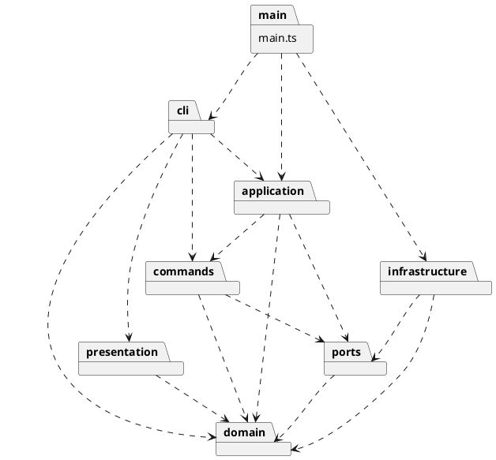

# Lab1 架构与开发记录

## 文档状态

第 1 阶段架构初稿。下文的类与功能除明确注明已实现外，均为后续计划，不表示当前已完成。
需求依据：`../phase_cli_1.md`。当前范围为 CLI、六种内置图形和任务书列出的全部命令；不开发 Web 界面、box 或动态插件加载。

## 架构方案

### 模块划分

| 目录 | 职责 | 计划中的主要类 / 接口 |
|---|---|---|
| src/cli | REPL、分词、语法解析、命令分发、统一终端错误输出 | CliApplication、Tokenizer、Token、TokenCursor、CommandRouter、各命令 Parser |
| src/domain | 几何行为、图形树、全局 ID 唯一性、父子约束 | Shape、Rect、Circle、Ellipse、Line、TextShape、Group、SvgDocument、ShapeFactory |
| src/commands | 命令协议、操作及其恢复信息 | Command、UndoableCommand、MoveCommand、DeleteCommand 等 |
| src/application | 当前文档、执行协调、历史规则 | EditorSession、CommandExecutor、CommandHistory |
| src/ports | 文档读写接口、执行上下文所需的抽象接口 | DocumentRepository、CommandContext |
| src/infrastructure | XML 解析与输出、文件系统访问 | SvgFileRepository、SvgReader、SvgWriter |
| src/presentation | tree/show 的文本排版 | TreeFormatter、ShapeFormatter |
| src/main.ts | 组合入口，创建并连接具体实现 | 无领域逻辑 |
| tests | 领域约束、命令历史、CLI 与读写验证 | 按功能分组的测试 |

组件/包图源文件：[architecture.puml](architecture.puml)。以下为相同依赖规则的 PlantUML 包图，可用支持 PlantUML 的工具预览；本阶段未生成渲染图片。

### 设计模式的选择

- **Command（必需）**：编辑操作封装为命令对象，执行成功后才记入历史。历史管理器只调用接口，不识别具体命令名。查询命令不入栈；成功的文档操作触发历史屏障。undo/redo 不记录为新的编辑。第 4 阶段开始落地，当前没有命令实现。
- **Composite**：Shape 为统一抽象，Group 保存有序子节点。叶子处理自身几何，容器通过多态递归操作；移动和缩放不得让同一个叶子重复变化。第 2 阶段开始落地。
- **Factory / 类型注册**：六种类型通过 ShapeFactory 集中构造，CLI 创建与 SVG 导入复用同一类型注册入口。具体类型定义处理自身参数，避免输出和读取模块各写一套 switch(tag)。未来插件加载不在本阶段实现。
- **撤销恢复策略（候选）**：优先评估操作涉及的状态快照；复杂树操作允许文档快照。必须保留原父级、顺序、属性是否存在等信息，不能仅使用数学逆运算。快照须深拷贝并恢复索引；若恢复时替换对象，历史命令应按 ID 解析目标，避免持有过期对象引用。第 4 阶段决定最终方案并记录理由。

按名字分发仅保留两处：CommandRouter（命令名）和 ShapeFactory（图形类型名）。依任务书标为**待重构点**：后续改为可注入注册、减少修改中央清单的需求；注册表仍是名字分发，不能以此规避约束。
属性白名单由各图形封装，不在命令中根据图形类型分支。tree/show 和 SVG 输出使用多态描述或访问者，具体选择随对应阶段记录，当前不预建复杂框架。

### 依赖方向规则

1. domain 不依赖其他业务模块，不读取 stdin、不 console.log、不访问文件系统；负责保护状态约束。
2. ports 可以引用 domain 类型，不引用具体实现。CommandContext 抽象声明在 ports；命令不能反向依赖 application 的具体会话类，避免循环依赖。
3. commands 只依赖 domain、ports 及本模块协议；application 依赖 commands、domain、ports。
4. cli 可依赖 application、commands、presentation、domain 的参数/构造契约，不直接访问文件实现。语法校验属于 CLI，ID 存在性、环和归属校验属于领域执行过程。
5. infrastructure 实现 ports，依赖 domain；内层不依赖 infrastructure。presentation 只读取 domain 的公开查询能力，不修改模型。
6. main.ts 是组合根，可组装所有模块；测试可导入被测模块。禁止通过组合根中转业务逻辑。
7. 一类一文件，文件名与类名一致。属性和子节点不作为可任意修改的公共数据袋暴露。统一从文档入口维护树与 ID 索引。

### 变化点假设

| 变化点 | 当前预留 | 暂不实现及理由 |
|---|---|---|
| 增加图形类型 | Shape 多态和集中工厂 | 不实现动态插件系统，box 明确为后续阶段 |
| 增加命令 | Command 协议与命令解析器注册 | 不构建通用脚本语言 |
| CLI 改为 GUI/其他输入 | 输入输出与领域分离 | 不开发 Web 或鼠标交互 |
| 文件来源或格式变化 | DocumentRepository 接口 | 不支持网络存储或任意格式 |
| 撤销规模增加 | 独立历史管理器 | 本阶段不做持久化历史、压缩或无限历史优化 |
| 展示格式变化 | 独立 Formatter | 不自建 SVG 渲染器，浏览器预览即可 |

### 语义与边界决策

**任务书明确要求，后续必须遵守：**

- ID 全文档唯一且大小写敏感；create/group 必须显式命名，导入缺 ID 时补齐并警告。
- scale 因子为正，位置和尺寸一起缩放；容器递归处理子孙。
- 根级 g 不允许 ungroup。分组不能同时选择祖先与后代；移动归属不能产生环。
- 一个编辑命令为一个 undo 单元；失败不修改文档或历史，新成功编辑清空 redo。
- init/read/save/修改画布后禁止撤销重做，下一次成功编辑解禁；查询 canvas 不改变历史。
- 只支持六种内置类型；box 报未知类型。颜色省略不写属性；文本写为 XML 子文本。

**初步建议，尚未成为已确认要求；相关功能实现前再明确：**

| 问题 | 初步建议 | 状态 |
|---|---|---|
| 文档操作后旧历史是否可再次访问 | 成功的历史屏障清空旧栈并设禁用标志，新编辑开启新历史段 | 待确认；任务书只明确禁用/解禁 |
| 不同父级元素 group 的新组位置与顺序 | 候选为最近公共祖先下插入，按原文档遍历顺序收编；同父级插入最早选中位置 | 待确认，涉及验收语义 |
| 外部 transform 与未知 SVG 内容 | 首先界定支持子集；不支持的影响视觉语义的结构不得静默丢弃 | 待确认，背景示例不等于完整 SVG 支持要求 |
| set g fill | 设置组自身属性，依 SVG 继承影响未显式指定的后代，不覆盖后代已有颜色 | 建议方案，需记录最终决定 |
| init 后首次 save path | 成功后记录该路径，供后续无参数 save 使用 | 建议方案 |
| 重复 ID、尺寸边界、空历史错误文案 | 重复 ID 拒绝导入；有限数值校验；具体尺寸范围和错误文案实现前确定 | 待细化 |
| 元素统计 | 统计全部图形及 g，不含 svg 根；任务书 6.1 版本 A 应为 9，示例写 8 | 已识别示例不一致，需统一验收口径 |

导入实现应先解析与验证完整候选文档，成功后再替换当前文档；先收集所有显式 ID，再给无名元素分配不冲突的 ID。

## 过程记录

### 第 1 阶段：2026-10-30

- 用户确认分阶段开发：每轮只完成当前阶段及必要验证，由用户自行 commit；不一次性生成全项目后再拆提交。
- 明确 TypeScript 能实现面向对象 CLI；当前项目不是 Web 应用，命令解析器只是其中一层。
- 讨论将字符串处理分成分词、语法解析、领域执行；带空格文本不能简单 split，行首注释与颜色值中的 # 必须区分。
- 修正架构潜在循环依赖：命令使用 ports 中的上下文接口，不导入 application 具体会话类。
- 明确模式与阶段边界：注册表仍是按名字分发；Command 不自动保证原子性；第 1 阶段不生成空命令类或完整领域模型。
- 当前只实现可运行入口和工具配置；业务类、模式实现及业务测试均属后续工作。

### 固定开发与提交顺序

1. 工程骨架、架构初稿。
2. 图形领域模型与 Composite 行为。
3. 文档、树约束与 ID 管理。
4. Command 执行与撤销重做，先接入创建和移动。
5. CLI 解析与 REPL，接入基础查询。
6. 其余编辑命令（必要时拆分基本属性编辑、复杂树编辑两次提交）。
7. SVG 读写与文档生命周期。
8. 全量验收、架构一致性检查与文档定稿；发现的代码修复单独提交。

每阶段同步必要验证和过程记录，不提前生成后续完整代码；用户手动提交并可推送。最终验收后才打 final 标签。

## 一致性自查

### 模块划分

第 1 阶段已建立规划目录，未实现模块仅用 .gitkeep 保留目录，不代表功能已实现。
实际业务源码仅 src/main.ts 与 src/cli/CliApplication.ts；符合一类一文件。尚无目录偏离。

### 依赖方向

当前唯一跨文件业务导入为 main.ts → cli/CliApplication.ts，符合组合根规则。没有逆向依赖。
后续新增模块时检查 import，重点检查 domain 是否依赖 IO、commands 与 application 是否形成环，以及是否增加类型名分派点。

## 质量保证手段

当前使用 TypeScript strict、noUncheckedIndexedAccess、exactOptionalPropertyTypes、noImplicitOverride 与 noEmitOnError。
通过 npm run check 验证类型检查与编译，通过 npm run cli 验证启动入口。
Node 内置测试入口已配置，但本阶段无业务功能，测试数为 0；不能据此声称 SVG 功能通过测试。
依赖版本由 package-lock.json 锁定，使用 npm ci 复现安装。

后续验证随功能同步：

- 领域：唯一 ID、有限数值、父子一致性、环检测、递归移动/缩放只执行一次。
- 命令：执行/撤销恢复相同状态，失败前后状态一致，分组或删除恢复父级与位置。
- 历史：新编辑清 redo，失败不清 redo，显示不改历史，文档命令历史屏障。
- CLI：引号、空文本、空行、注释与颜色、in 子句、缺参/多参/非法数字。
- SVG：文本转义、无名 ID 与已有 ID 冲突、读写往返、读取失败保留旧文档、保存失败不改会话。
- 整体：回放任务书适用会话并打开生成 SVG；box 等后续阶段示例不计入本阶段必做。

最终文档将补充真实测试结果和剩余限制，不提前宣称全部功能完成。

### 第 1 阶段实际验证结果

- npm run check：通过严格类型检查、测试发现和编译；测试 0 项，暂无业务覆盖。
- npm run cli：正常输出工程阶段说明并退出，无伪装成已完成的编辑命令。
- git diff --check：通过；git check-ignore 确认 node_modules、dist、.npm-cache 均被忽略。
- 安装开发依赖 TypeScript 7.0.2、@types/node 20.19.43，生成 package-lock.json；安装报告未发现已知漏洞。
- 初次安装被全局 npm 缓存写权限阻止，改用项目内 .npm-cache，并通过本次命令指定官方 registry 成功安装；未修改全局 npm 配置。安装进程显式启用了 TLS 校验。
- PlantUML 提供可预览源文件，本阶段未进行图像渲染验证。
- 未执行 git add、commit、push 或 tag，交由用户审阅并提交。
